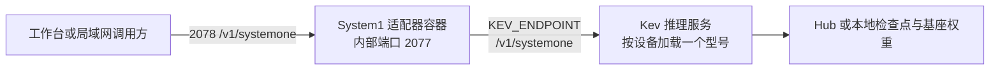

# System1 与 Kev 多规格模型部署指南

本指南面向使用 Docker Compose V2 的 NAS / Linux 主机。它把 **Gods-Workbench System1 适配器**与**Kev 推理服务**分开说明：System1 不含模型权重、不下载模型，也不选择 Kev 型号；它把一个统一决策请求转发给 `KEV_ENDPOINT` 指向的 Kev 服务。



## 1. 选模型和机器

Kev 是**决策模型**：输入状态文本和一个或多个 `choice`、`noul`、`score` 问题，返回选项概率/分数；它不负责通用聊天文本生成，也不是工具调用模型。Kev 1.0 官方建议从 4B 开始，有更大 GPU 再考虑 9B；有 80GB GPU 且追求该系列最高准确度可考虑 27B；只有在体积更重要时考虑 0.8B。

| 型号 | Kev 官方公布的运行参考 | 官方验证上下文 | 通用 NAS 建议 |
|---|---|---:|---|
| 0.8B | CUDA：L4 或任意 4GB GPU；Apple Silicon Mac 可运行 | 8,192 tokens | CPU NAS 可作为低资源试跑候选；先测内存、启动和实际请求耗时。Kev 官方未给出通用 NAS CPU 内存/速度保证。体积较小，准确度也低于大型号。 |
| 4B | CUDA：L40S / H100；官方也测过 32GB Apple Silicon Mac | 8,192 tokens | 上游推荐的默认起点。普通 NAS 通常更适合让有兼容 GPU 的独立主机运行，再由 System1 走局域网调用。 |
| 9B v2 | CUDA：L40S / H100；32GB 或更大 Apple Silicon Mac 属于预期配置，未实测 | 8,192 tokens | 适合显存更充足的 GPU 主机；不要把未实测 Mac/NAS CPU 当作已验证配置。 |
| 27B v2 | B200 / H200 / H100 80GB；96–128GB Apple Silicon Mac 是预期配置，未实测；官方模型卡记录约 55GB GPU 常驻内存 | 65,536 tokens | 面向数据中心级 GPU，不是普通 NAS 的 CPU 负载。模型权重约 51GB，显存还要为服务缓冲区留空间。 |

上表是 Kev 上游发布的硬件与准确度验证信息，不是 Gods-Workbench 对所有硬件的兼容承诺。小型号服务端可以接受最长 65,536-token 状态，不代表超过 8,192-token 的准确度已经验证；27B 的上下文验证边界为 65,536。Kev 官方模型卡列出的语言为英语；中文决策质量未由本项目验证，使用中文业务文本前应自行准备代表性样本评估。

Kev 1.0 发布说明还特别提醒：Kev-0.8B 不应拿来做工具调用路由。若 System1 的选择会触发外部工具，应先用目标语言和真实选项集验证较大型号，再由调用方保留人工/安全门禁。

**简单选择：**

- 只有 NAS CPU：先试 0.8B；如 NAS 无法安装 Kev 所需 Python/依赖，或耗时、内存不合适，把 Kev 服务放到另一台 Linux 主机。
- 有 NVIDIA GPU 主机：优先从 4B 开始；显存更大、评测确有收益再换 9B。
- 有 H100 80GB / H200 / B200：可部署 27B；需要处理长文本时也要按模型卡和自有语料实测。
- Kev 推理服务可在与 Gods-Workbench 不同的主机上；NAS 只承担 System1 适配器和数据服务。

## 2. 下载模型

Kev 官方仓库要求 Python 3.12 或 3.13、使用 `uv` 从源码安装。**不要执行 `pip install kev`**：上游说明该 PyPI 名称属于另一个旧项目。Kev 的 0.8B / 4B / 9B 官方 release tarball 只包含 Kev adapter、head、tokenizer 和随包元数据，**不包含 Qwen 基座模型**；首次启动仍需联网下载基座。27B 是完整权重，约 51GB，只从 Hugging Face Hub 获取，不在 GitHub release 包内。

Kev 1.0 官方下载页：[GitHub Release `kev-1.0`](https://github.com/jaredpalmer/kev/releases/tag/kev-1.0)。单包下载地址格式如下：

```sh
mkdir -p "$HOME/models/kev"
cd "$HOME/models/kev"
curl -fL -o kev-4b.tar.gz \
  https://github.com/jaredpalmer/kev/releases/download/kev-1.0/kev-4b.tar.gz
printf '%s  %s\n' \
  '2e707e2ebd08980dc7881222b7024cea5606401441c1a086afb170ae7784201c' \
  'kev-4b.tar.gz' | sha256sum --check -
tar -xzf kev-4b.tar.gz
```

下载其他小型号时，把包名和 SHA-256 一起替换：

| GitHub Release 文件 | 文件大小 | Kev 权重 revision | SHA-256 |
|---|---:|---|---|
| `kev-0.8b.tar.gz` | 46 MB | `jaredpalmer/kev-0.8b@9a45d25e` | `0ae144c7675f0c3f333be0bb878a0f202ab9e6fa84169fb7cb16efe6176c1ef1` |
| `kev-4b.tar.gz` | 131 MB | `jaredpalmer/kev-4b@139fdd94` | `2e707e2ebd08980dc7881222b7024cea5606401441c1a086afb170ae7784201c` |
| `kev-9b.tar.gz` | 172 MB | `jaredpalmer/kev-9b@b5d8c18e` | `acd13320b7d1b052ce989f19ca9d1d9ba5219b8beced0ee67337908aef1deb3f` |

macOS 校验可用 `shasum -a 256 -c -`，其余格式相同。发布包文件小是因为基座没有放进包里；不能据此估算 Kev 完整运行内存。

解压后可把本地目录传给 Kev 的 `--run`：

```sh
uv run --extra serve python -m kev.serve \
  --run "$HOME/models/kev/kev-4b" \
  --device cuda --host 0.0.0.0 --port 8009
```

即使使用本地 release tarball，缺少的 Qwen 基座仍需在首次启动时从 Hub 获取；本地包不是全离线模型包。

27B 可在启动时从 Hub 拉取：

```text
jaredpalmer/kev-27b@v1.0
```

第一次启动需要约 51GB 模型权重下载空间，另留 Hub 缓存、临时文件和服务运行内存空间。若 NAS 无法访问 Hugging Face Hub，应在可联网的兼容主机上准备模型缓存，再按 Hugging Face 缓存规则搬运；GitHub 上的三个小型号 tarball 本身不能构成完全离线包。

## 3. 在 Kev 主机启动推理服务

在将要运行模型的 Linux 主机或 NAS 上安装 Python 3.12/3.13 与 `uv`，然后按 Kev 官方仓库安装服务依赖：

```sh
git clone https://github.com/jaredpalmer/kev.git
cd kev
uv sync --extra serve
```

Kev 上游服务首次启动会从 Hub 下载 Kev 检查点；小型号还会下载对应 Qwen 基座。模型由 `--run` 决定。以下命令都在 **Kev 推理主机**运行，不是在 `gods-workbench-system1` 容器里运行。

### NAS CPU 试跑：0.8B

```sh
uv run --extra serve python -m kev.serve \
  --run jaredpalmer/kev-0.8b@9a45d25e \
  --device cpu --host 0.0.0.0 --port 8009
```

Kev 在 CPU 上默认采用 fp32 路径，NAS 性能取决于 CPU、内存、线程和输入长度；应从单请求开始测量，不要把模型参数量直接等同于所需 RAM 或响应时间。

### 独立 NVIDIA GPU：4B 或 9B

Kev 官方推荐从 4B 开始；有更大 GPU 再评估 9B：

```sh
# 4B
uv run --extra serve python -m kev.serve \
  --run jaredpalmer/kev-4b@139fdd94 \
  --device cuda --host 0.0.0.0 --port 8009

# 9B v2（另一个服务实例应使用不同端口）
uv run --extra serve python -m kev.serve \
  --run jaredpalmer/kev-9b@b5d8c18e \
  --device cuda --host 0.0.0.0 --port 8010
```

### 80GB 级 GPU：27B

```sh
uv run --extra serve python -m kev.serve \
  --run jaredpalmer/kev-27b@v1.0 \
  --device cuda --host 0.0.0.0 --port 8009
```

Kev README 说明默认 `--device auto` 会探测 CUDA/ROCm、Apple Silicon MPS/MLX，再回退到 CPU；NAS 排障时可显式指定 `--device cpu`，GPU 主机可指定 `--device cuda`。这些设备选择不替代显存/内存容量验证。

服务前台运行时保持终端不退出。要长期运行，应使用 NAS 的进程/容器管理功能托管这个 Kev 命令，并把 Hugging Face 缓存放在持久化磁盘。**这与本仓库的 System1 Compose 是两份服务配置**：Kev 进程加载模型；System1 容器只转发 API。本指南不声称 Kev 已作为本项目 Compose 镜像交付。

先从 Kev 主机本机验证模型服务：

```sh
curl -fsS http://127.0.0.1:8009/v1/models
```

响应应包含当前服务模型名称、权重/基座、设备和 backend/precision 等信息。若连接失败，先处理 Kev 进程、模型下载、CUDA 与本机端口，再配置 Workbench。

## 4. 配置并启动 Workbench System1 适配器

在 Gods-Workbench 仓库根目录运行。先复制配置：

```sh
cp deploy/docker/.env.system1.example deploy/docker/.env.system1
```

编辑 `deploy/docker/.env.system1`：

```dotenv
SYSTEM1_PORT=2078
GW_ALLOWED_HOSTS=nas.example.invalid
KEV_ENDPOINT=http://kev-host.example.invalid:8009/v1/systemone
```

- `KEV_ENDPOINT` 必须是 Kev 主机从 **System1 容器内部**可访问的完整 API URL。把示例域名替换为你的 Kev 主机 IP/DNS；若 Kev 与 System1 不在同一容器，不要填 `127.0.0.1`。
- 若 Kev 也在 Docker 中，服务名只有在两个容器加入同一个 Docker network 时才可直接解析；否则使用容器可路由到的 NAS/LAN 主机地址，并确认防火墙放行。
- `GW_ALLOWED_HOSTS` 是浏览器/客户端访问 **System1 宿主**时发送的 Host 主机名或 IP，不是 Kev 地址；不要写协议、端口或 `*`。若客户端用 NAS IP 访问，就填该 IP；如同时用 DNS 名访问，用逗号分隔列出两者。
- `SYSTEM1_PORT` 是 NAS 宿主端口，默认 2078；容器内部固定 2077。它与主应用的宿主端口 2077 分开。
- `.env.system1.example` 中的 `.invalid` 域名是保留示例，必须替换；它不会自行发现 NAS 或 Kev 服务。

校验、构建、启动：

```sh
docker compose -p gods-workbench-system1 \
  --env-file deploy/docker/.env.system1 \
  -f deploy/docker/docker-compose.system1.yml config --quiet

docker compose -p gods-workbench-system1 \
  --env-file deploy/docker/.env.system1 \
  -f deploy/docker/docker-compose.system1.yml up -d --build

docker compose -p gods-workbench-system1 \
  --env-file deploy/docker/.env.system1 \
  -f deploy/docker/docker-compose.system1.yml ps

docker compose -p gods-workbench-system1 \
  --env-file deploy/docker/.env.system1 \
  -f deploy/docker/docker-compose.system1.yml logs --tail=100 system1
```

`/healthz` 只表示 System1 Web 服务已启动，不证明 Kev 模型已下载或 endpoint 可访问。Kev 主机有 `/v1/models`；System1 适配器没有模型列表代理端点。

## 5. 调用与验证

### 直接调用 Kev 原生 API

Kev 原生 `POST /v1/systemone` 接收 `state`、`model` 和 `questions`。例如：

```sh
curl -fsS http://127.0.0.1:8009/v1/systemone \
  -H 'Content-Type: application/json' \
  -d '{
    "state": "A customer reports two charges for one order and requests a refund.",
    "model": "kev-latest",
    "questions": {
      "department": {
        "type": "choice",
        "instructions": "Which team should handle this case?",
        "criteria": {
          "billing": "Charges, invoices and refunds",
          "shipping": "Delivery delays or lost packages",
          "returns": "Exchanges and wrong-size items"
        }
      },
      "urgent": {
        "type": "noul",
        "instructions": "Does this need urgent human attention?"
      }
    }
  }'
```

响应中查看 `answers.department.choice`、`answers.department.probabilities` 和 `answers.urgent.noul`。`confidence` 是模型输出的置信度，不是实际准确率；不确定或高后果决策应交由人工复核。Kev 接受 `choice`（多选）、`noul`（是/否概率）和 `score`（有序等级）三类问题。

### 经 System1 适配器调用 Kev

从局域网调用 NAS 的宿主端口。把 URL 中的 NAS 主机换成配置 `GW_ALLOWED_HOSTS` 时使用的同一地址：

```sh
# 先替换为客户端访问 NAS 时使用的主机名/IP，并与 GW_ALLOWED_HOSTS 一致
NAS_HOST=nas.example.invalid
curl -fsS "http://${NAS_HOST}:2078/v1/systemone" \
  -H 'Content-Type: application/json' \
  -d '{
    "type": "choice",
    "provider": "kev-cpu",
    "prompt": "A customer reports two charges for one order and requests a refund. Choose the team that should handle the case.",
    "options": [
      {"id": "billing"},
      {"id": "shipping"},
      {"id": "returns"}
    ]
  }'
```

当请求确实经过 Kev 时，响应 `provider` 应为 `kev-cpu`，并包含 `result.choice_id`、`probabilities` 与 `debias`。当前通用适配器把 `prompt` 作为 Kev 的 state、把选项 `id` 作为 Kev `choice` criteria；工作台请求里的 `label` 不会作为 Kev 选项说明传递。因此，使用 System1 入口时把分类说明写进 `prompt`，并让选项 ID 本身含义清楚。若 `provider` 返回 `local`，说明本次结果没有来自 Kev，应检查 `KEV_ENDPOINT`、Kev 日志和网络连接后再验收。

Workbench 适配器调用的是 `.env.system1` 中唯一的 `KEV_ENDPOINT`。选择模型的地方是 Kev 启动命令的 `--run` 参数；换模型要在 Kev 主机更换该参数并重启 Kev，再确认 System1 endpoint 指向该服务。单个 System1 实例不提供运行时模型下拉选择。

如果 `SYSTEM1_PORT` 改过，curl URL 的 `2078` 也要替换成配置的宿主端口。

## 6. 网络与安全

- Kev 服务默认不要求 API key。当前 Workbench Kev 适配器只发送请求 JSON，不转发 `Authorization: Bearer ...`，所以配置了 Kev `KEV_API_KEY` 后该适配器无法通过认证。
- 当前 System1 `/v1/systemone` 路由没有单独的登录/用户认证依赖；能连到端口并通过 Host 检查的客户端可以发起决策请求。
- 把 Kev 和 System1 限制在可信局域网/容器私有网络内，用 NAS/主机防火墙只允许需要的来源访问端口；不要给 Kev 或 System1 做公网端口转发。
- `--host 0.0.0.0` 是为了让其他 LAN 设备或容器能连到 Kev 进程，不代表应该允许公网访问。
- `GW_ALLOWED_HOSTS` 只检查访问 System1 时的 Host；它不是用户认证、防火墙或 Kev API key。
- 需要在不可信网络使用时，应在它们前面配置有认证的私有网关/反向代理，不能把 Host 白名单当作认证措施。

## 7. 常见问题

| 现象 | 检查 |
|---|---|
| `Invalid host header` | `GW_ALLOWED_HOSTS` 是否包含客户端 URL 中的 NAS 主机名/IP；值不带 scheme 和端口。 |
| Kev 主机 `/v1/models` 不通 | Kev 进程是否仍运行、端口是否监听、模型是否下载完成、主机防火墙是否允许来源。 |
| System1 是 `healthy` 但决策失败 | `healthy` 只测 `/healthz`；从容器网络确认 `KEV_ENDPOINT` 可达，检查 Kev 服务日志。 |
| 返回 `provider: local` | 响应走了本地兜底而非 Kev；修复 endpoint/网络后再确认 `provider: kev-cpu`。 |
| 模型下载失败 | 检查模型主机到 GitHub/Hugging Face 的访问和持久缓存空间；小型号 tarball 不含 Qwen 基座。 |
| 显存不足 | 换更小型号，或释放显存/增加显存；27B 官方参考为 80GB GPU，不要只按 51GB 权重文件大小配卡。 |
| NAS CPU 速度或内存不理想 | 从 0.8B 单请求测试；若不满足负载，保留 NAS 的 Workbench 服务，把 Kev 移至 GPU 主机。 |

停止 System1 但保留其运行数据卷：

```sh
docker compose -p gods-workbench-system1 \
  --env-file deploy/docker/.env.system1 \
  -f deploy/docker/docker-compose.system1.yml down
```

不要附加 `-v`，以免删除 Docker 管理卷。Kev 模型缓存由 Kev 主机管理，不在 System1 卷里。

## 官方资料

- [Kev 官方仓库（安装、硬件表、API）](https://github.com/jaredpalmer/kev)
- [Kev 1.0 发布说明（revision、tarball、SHA-256、27B 下载）](https://github.com/jaredpalmer/kev/blob/main/docs/releases/kev-1.0.md)
- [Kev-0.8B 模型卡](https://huggingface.co/jaredpalmer/kev-0.8b)
- [Kev-4B 模型卡](https://huggingface.co/jaredpalmer/kev-4b)
- [Kev-9B 模型卡](https://huggingface.co/jaredpalmer/kev-9b)
- [Kev-27B 模型卡](https://huggingface.co/jaredpalmer/kev-27b)
- [uv 安装文档](https://docs.astral.sh/uv/getting-started/installation/)
