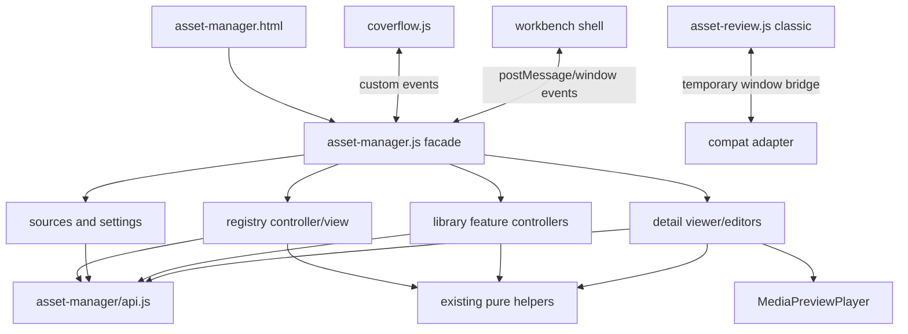

# `asset-manager.js` 渐进拆分方案

> 状态：待用户评审的工程方案；本文件不授权或实施源码改动。
> 基线：`origin/master` `69860b0b4520fe3e7bad11b4a9c48fcd1c3d35f6`。

## 目标与边界

QIN-382 要求把 `web/js/modules/asset-manager.js` 的职责分区、模块边界、依赖关系、迁移顺序和各步回归测试整理成可评审方案。当前文件在上述基线实测为 **18,670 行**；调研来源记录为 18,627 行，本文的符号和行号以本次实测基线为准。

拆分采用渐进迁移：保留资产页入口和既有行为，每个后续工单只移动一个稳定边界，先以显式接口隔离状态，再改变文件归属。早期拆分不改 API、数据格式、localStorage 键、权限、CAS 或页面交互，不做整体重写，也不引入框架或构建链。

本票只新增此文档。后续实现需用户评审并另行拆票、授权；所有触碰 `asset-manager.js` 的执行票按该热点文件串行建立 Linear `blocked-by`，避免并行改同一文件。

## 基线结构与已存在的边界

`asset-manager.js` 目前兼任应用装配、页面状态、数据查询、视图渲染、DOM 事件处理和多类资产编辑。主要区块锚点如下（行号会随代码迁移漂移）：

| 基线位置 / 符号 | 当前职责 |
| --- | --- |
| 25–798，页面级变量、`loadRegistryPrincipal`、通知与触控条上下文 | 页面启动上下文、权限/身份、通用反馈、宿主桥接 |
| 799–3019，`renderBoardNavigation`、`openStorageSettings`、`saveStorageSettings`、项目目录模板与缩略图生成 | 看板/来源配置、目录设置、项目目录模板、缩略图任务 |
| 3020–4000，素材类型/分类、local/shared folders、canvas 与 library 选择器 | 多资产来源的模型转换、分类和选择上下文 |
| 4000–6610，结构、版本、筛选、分页、索引轮询与 `loadAll` | 注册表查询与刷新、自动索引对账、缓存/预取、结构和回收站 |
| 6880–10008，`render`、`renderRegistryManager`、`renderLocalManager`、`renderWorkflowManager`、`renderPromptManager` | 多看板、多类型列表/卡片/详情面板渲染 |
| 9279–11256，上传/删除动作、`handleClick` 及其它 DOM 委托 | 上传、编辑、删除、键盘/指针/拖放与动作分发 |
| 11257–15886，`openAssetItem`、`renderDetailViewer`、媒体画布、Office/视频/音频/字体预览 | 统一详情查看、媒体预览、版本与审阅辅助 |
| 15887–17195，`openDetailImageEditor`、`renderDetailImageEditor` | 图像编辑器、画笔/图层及编辑交互 |
| 17196–18670，资产/提示词批量动作、宿主消息与全局监听 | 删除/提示词保存、消息协议、页面初始化和兼容桥 |

这些职责目前共享模块顶层可变状态；上表是迁移定位图，不意味着每个区块内部已经是独立服务。

已有可复用模块位于 `web/js/modules/asset-manager/`：`api.js`（约 934 行 API 门面）、`classification.js`、`storage.js`、`formatters.js`、`path-utils.js`、`workflow-assets.js`、`http.js` 和独立加载的 `coverflow.js`。新模块应复用这些边界，不复制 endpoint、分类逻辑或格式化实现。

页面与外部契约也需要保留：

- `web/embeds/asset-manager.html` 以 module script 加载 `asset-manager.js`，并由 `web/pages/assets.html`、设置页等通过 iframe 使用；`?settings=directories` 是目录设置入口。
- `coverflow.js` 与主模块通过 `gw:asset-coverflow-*` 自定义事件交互，而非直接导入主模块状态。
- classic `asset-review.js` 仍通过 `window` 桥接访问注册表选择、视频时间工具和详情动作。主模块当前提供 `readStoredBoolean`、`readStoredNumber`、`selectedRegistryAsset`、`registrySelectedIds`、`formatVideoSegmentTime/Range`、`alignTimeToFps`、`findMatchedVideoSegment`、`ensureMediaPreviewPlayer`、`seekDetailVideoTo`、`openRegistryAssetFromGlobalSearch` 等兼容能力。迁移早期保持这些能力可用。
- 外壳通过 `postMessage`/`message` 和 window 事件完成触控条上下文、主题、资产刷新/增量同步与 Omnibar 回跳。`asset-sync` 的轻量对账语义不能变成全量刷新。

## 目标模块边界

保留 `asset-manager.js` 作为稳定装配入口；业务模块以工厂/控制器形式显式接收 API、上下文、通知和回调。模块拥有自己的状态，不直接读写其它业务模块的闭包变量。

| 候选模块边界 | 负责内容 | 允许依赖 / 输出 |
| --- | --- | --- |
| `asset-manager.js`（facade） | 读取 URL/DOM 容器，构造 feature controllers，装配首次加载与根级事件；暂时保留外壳消息和兼容 globals | 调用 feature 的显式 API；不再承载领域查询与大块模板 |
| `asset-manager/registry/controller.js` | 注册表筛选上下文、请求序号/取消、分页游标、预取、索引轮询与对账、缓存、选择和回收状态 | 依赖 `assetManagerApi`、稳定 project/root context；输出只读 view model 和动作函数，不操作 DOM |
| `asset-manager/registry/view.js` 与 `interactions.js` | 注册表网格/列表、筛选 facets、选择条、结构/版本卡片及事件意图 | 从 controller 读 view model；调用 controller 动作；不发 HTTP、不拥有第二份选择状态 |
| `asset-manager/sources/boards.js` | 预设/自定义看板、来源注册/解绑、看板排序/隐藏、目录树关系 | 依赖 API 门面、稳定 root/source ID；解绑不删除宿主源文件 |
| `asset-manager/settings/` | 存储目录、AI/代理/预览设置、项目目录模板和缩略图任务的表单/控制器 | 依赖 API 与已有 storage/formatting helpers；保留权限、焦点返回、expected_version 和路径语义 |
| `asset-manager/libraries/` | Local/Shared 素材、Workflow 文档、Prompt 库、Project/Canvas 资产视图；按独立状态/API 面拆成单独后续票 | 依赖 API、纯转换 helper；以明确的 `asset_id`/`library_id`/`project_id` 和回调与注册表、详情页协作 |
| `asset-manager/detail/viewer.js` | 详情来源解析、媒体类型、预览播放器、版本/元信息和查看器快捷键 | 依赖 API、已有 `ensureMediaPreviewPlayer` 机制及格式 helpers；只通过稳定 asset/version ID 请求编辑动作 |
| `asset-manager/detail/media-canvas.js`、`image-editor.js` | 详情内媒体画布/批注与图像图层编辑 | 依赖详情 view model 与 API 回调；各自拥有临时交互状态和清理生命周期 |
| `asset-manager/compat.js`（晚期） | 对 classic `asset-review.js`、shell、Coverflow 的临时兼容桥 | 仅适配旧接口，不承载业务逻辑；只有所有消费者迁移并验收后才能另票移除 |

依赖方向：

硬边界：业务 feature 不互相 import；共享状态通过最小 context/getter/callback 暴露；跨 feature 写操作走拥有者的动作接口。`assetManagerApi`/`assetAuthApi` 是网络调用边界，不在 feature 内拼第二份 URL 或 fetch。稳定 ID、权限过滤、401 反馈、CAS `expected_version`、源文件不删除、索引增量/全量刷新区分、localStorage key 与宿主消息协议均作为迁移兼容条件。

## 建议迁移顺序与回归

每个实现票先增加/调整能失败的行为测试，再移动一块代码；一个 PR 不同时重命名公共 API、调整行为和搬文件。新建 Node 测试文件时必须登记到 `tests/frontend/node-files.txt`。源码抽取型测试应改为直接导入新模块或稳定 seam，不能因路径变化而删除断言。

| 顺序 | 后续票建议范围 | 主要回归测试 |
| --- | --- | --- |
| 0. 固定 seam | 为页面启动、project context、消息兼容和源文件静态 harness 建立稳定测试入口；保留当前通过的断言 | `tests/frontend/workflow-assets.test.mjs`、`http-transport-asset-helpers.test.mjs`、`c5-context-error-states.test.mjs`、`test_c18_video_jump.mjs`；覆盖页面 module 启动及 classic consumer 的浏览器 smoke |
| 1. 注册表数据控制器 | 先搬请求序列、分页/预取、缓存、索引轮询和对账；UI 仍由旧入口渲染 | `tests/contracts/assets/test_dir_t9_media_range_pagination.py`、`test_c11_filter_cursor.py`、`test_qin_370_asset_index_batching.py`；`tests/e2e/test_c10_asset_scale_browser.py`；project context Node 测试 |
| 2. 注册表视图与交互 | 拆 grid/list/facets/选择条/结构视图；所有点击转为 controller intent | `tests/e2e/test_dir_t4_preview_browser.py`、`test_c10_asset_scale_browser.py`；回收/单文件操作使用 `test_dir_t6_single_file_operations.py`、`test_dir_t11_asset_recovery_browser.py` |
| 3. 来源、看板与设置 | 看板/来源注册和目录、模板、缩略图/代理设置分开搬；保持路径、权限和 CAS 语义 | `tests/contracts/assets/test_dir_t1_registry_roots.py`、`test_dir_t6_single_file_operations.py`；目录/来源变更需跑 `test_dir_t9_local_assets_pagination_browser.py` 与 `test_dir_t11_asset_recovery_browser.py` |
| 4. 资产库模式 | Local/Shared、Workflow、Prompt、Project/Canvas 每种状态/API 面独立成票，不合并为一个“library 大模块” | `tests/frontend/workflow-assets.test.mjs`、`c5-context-error-states.test.mjs`；`tests/contracts/assets/test_phase11_b4_asset_library.py`、`test_c5_asset_project_context.py`；local pagination browser test |
| 5. 详情查看与媒体画布 | 先提取查看器和播放器接线，再拆媒体画布/批注；维持资产类型、版本和时间码 | `tests/frontend/test_c18_video_jump.mjs`、`tests/e2e/test_c18_video_jump_browser.py`、`test_dir_t4_preview_browser.py`；相关媒体契约 `tests/contracts/assets/test_phase11_b5_media.py` |
| 6. 图像编辑器 | 独立迁移编辑器状态、绘制/图层和撤销等动作；先补当前缺少的行为级浏览器回归 | 为编辑器增加聚焦浏览器测试；Node 测试覆盖抽出的纯坐标/变换 helper；相关媒体契约回归 |
| 7. facade 与兼容收口 | 各域稳定后缩小 `asset-manager.js`；classic review 与 shell/Coverflow bridge 的移除需单独列 AC 和确认没有剩余消费者 | 当前 Node manifest 全量、assets 相关 E2E、页面嵌入/目录设置两种入口；检查所有 window/global/event consumer |

上述测试是建议的逐步门禁，不宣称它们覆盖所有 UI。每张后续票应按实际改动再核对测试源；被搬移的函数若只有源码字符串测试，应迁移测试 seam，不可降级为宽松 snapshot。最终交付仍按仓库领单流程运行全量 pytest、Node manifest；Python 改动才需对改动文件跑 Ruff。

## 风险与验收检查

- **状态耦合**：模块顶层有大量共享状态。先确定每份状态的唯一 owner，禁止用共享可变单例或重复镜像状态快速“切文件”。
- **跨域回归**：一个资产可能同时出现在注册表、local/canvas 视图、Coverflow、详情和项目上下文。跨模块只传稳定 ID 和必要快照；不能因拆分丢掉来源或切回默认项目。
- **异步一致性**：registry 请求序号、AbortController、cursor、预取独立状态与 index reconcile 是整体不变量；保持迟到响应丢弃和刷新语义。
- **兼容与装配**：HTML 加载顺序、目录设置 iframe、classic `asset-review.js`、`window.MediaPreviewPlayer`、shell 消息及 Coverflow event 名称均需有消费者清单和回归证据。
- **测试对源码路径的耦合**：已有 Node harness 直接从 `asset-manager.js` 读函数片段。搬迁时改为导入模块或注入 seam，保留相同行为断言。
- **范围控制**：此方案不授权任何源码改动，也不承诺性能阈值、全资产规模或新功能。文件布局与每张执行票需在用户评审后冻结；若评审要求的方案变化影响正式用户故事/路线，再先更新 USER-STORIES 与 ROADMAP。

**评审通过标准**：用户确认模块职责、依赖边界、迁移顺序及测试门禁后，可基于表中顺序拆成逐张串行工单；在其确认前，本文件仅是方案，不是代码实施授权。
